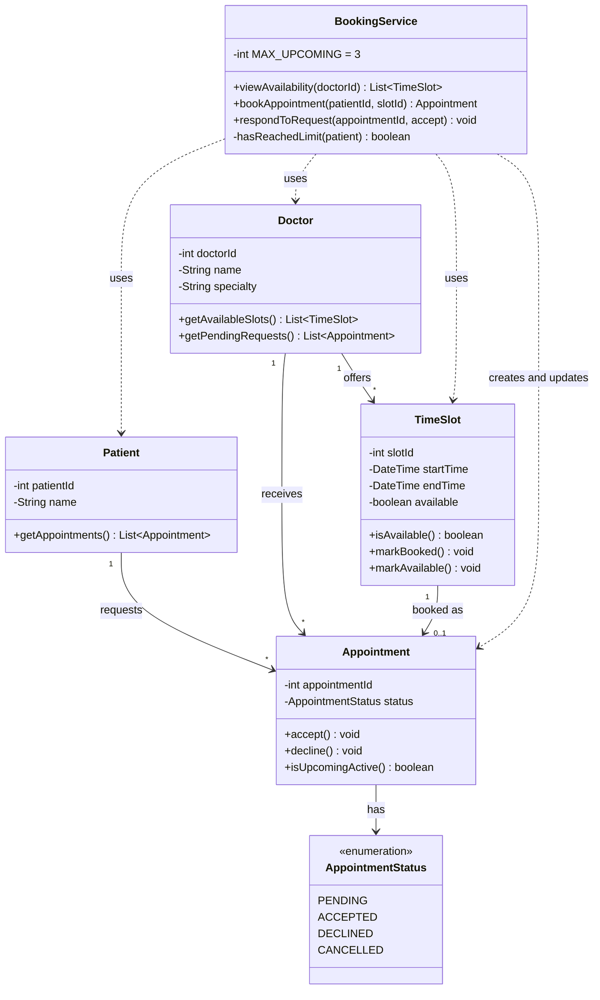

# Class Diagram - Doctor Appointment Booking System

This diagram is based on requirements R1-R4 (`requirements.txt`) and use
cases UC1-UC4 (`use_cases.md`). Chosen value: N = 3.

## Class responsibilities

| Class             | Responsibility |
|-------------------|----------------|
| Patient           | Holds patient identity and their appointments. |
| Doctor            | Holds doctor identity, offered time slots and incoming requests. |
| TimeSlot          | Represents one bookable day/time of a doctor and whether it is free. |
| Appointment       | Links a patient, doctor and slot, and tracks its status. |
| AppointmentStatus | Allowed states: Pending, Accepted, Declined, Cancelled. |
| BookingService    | Coordinates the flows and enforces the limit N = 3. |

## Traceability

| Requirement / Use case | Where it appears in the diagram |
|------------------------|---------------------------------|
| R1 / UC1 | `BookingService.viewAvailability()`, `Doctor.getAvailableSlots()`, `TimeSlot` |
| R2 / UC2 | `BookingService.bookAppointment()`, `TimeSlot.markBooked()`, `Appointment` |
| R3 / UC4 | `Doctor.getPendingRequests()`, `BookingService.respondToRequest()`, `Appointment.accept()/decline()` |
| R4 / UC3 | `BookingService.MAX_UPCOMING`, `hasReachedLimit()`, `Appointment.isUpcomingActive()` |

`isUpcomingActive()` is true only when the appointment is in the future and
its status is PENDING or ACCEPTED. DECLINED, CANCELLED and past appointments
return false, matching the counting rule in R4.

## Design decisions (not specified by the assignment)

- A declined appointment makes its time slot available again
  (`TimeSlot.markAvailable()`).
- `CANCELLED` exists in the enumeration because the assignment's counting
  rule mentions it, but no cancel feature is modelled or required.
- Availability data is preloaded (seed data), so there is no
  "set availability" operation.
- R5-R7 are non-functional and are not modelled as classes. They will be
  addressed in the README or design notes.
