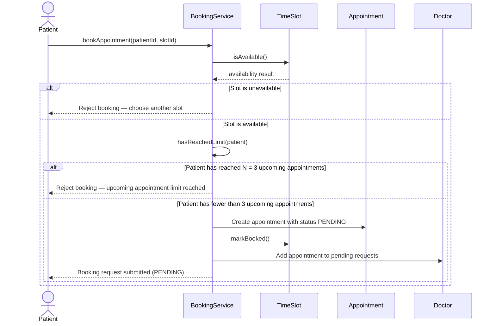

# Sequence Diagram — Book an Appointment

## Notes
- `N = 3`.
- Only future appointments with status `PENDING` or `ACCEPTED` count toward the limit.
- `DECLINED`, `CANCELLED`, and past appointments do not count.
- The request remains `PENDING` until the doctor accepts or declines it.
